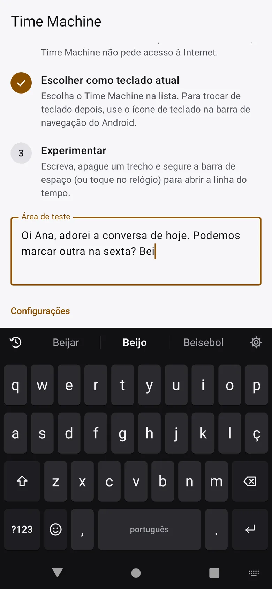
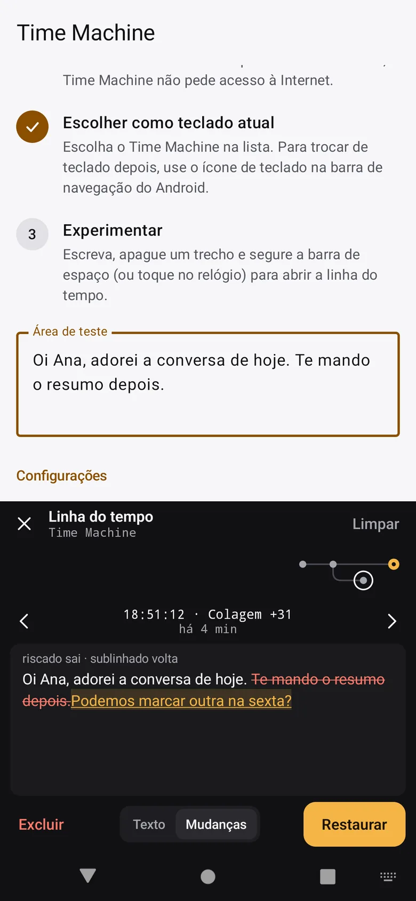
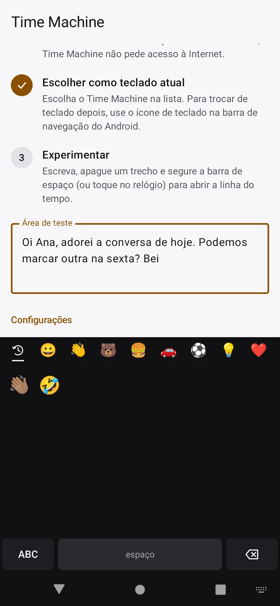
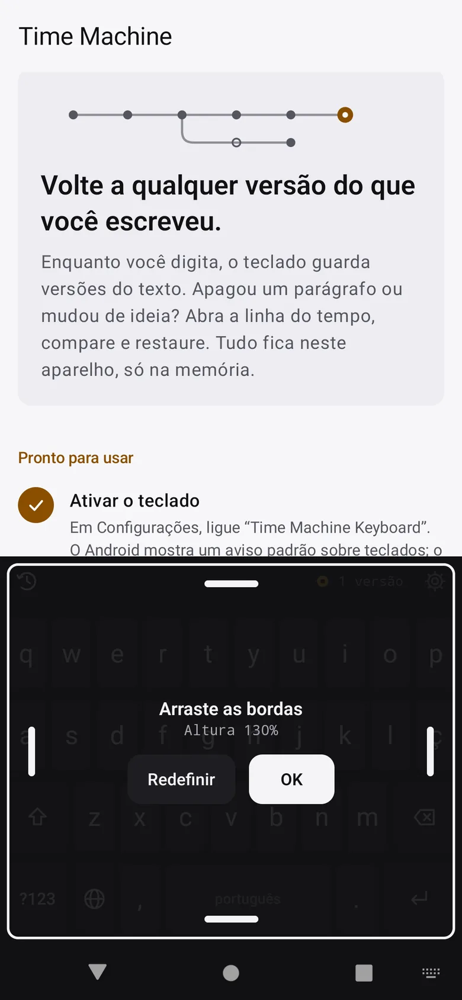

# Time Machine Keyboard

**English** · [Português](README.pt-BR.md)

An Android keyboard that keeps versions of your text while you type and lets you go back to any of them, like version control built into the keyboard. It works offline, with no backend and no AI, and the history lives only in the device's memory.

> Core rule: the keyboard never claims it can recover what it couldn't read. When an app doesn't let it read the whole field, the version is marked **partial** and is never used to replace the field.

<p align="center">
  
  
  
  
</p>

## Features

- **Version history while typing.** A new version is saved after each pause (500 ms by default) and right before destructive edits: the first backspace in a run, typing over a selection, pressing Send/Enter and restoring.
- **Timeline.** A git-style rail with branches, a text or "changes" preview (struck-through text would go, underlined text would come back) and nothing changes in the app until you tap **Restore**. Restoring is undoable.
- **Branches, not a stack.** Restoring an old version and typing again creates a branch; discarded versions are kept.
- **Safe restoration.** The current text is read in full and saved as "Before restore" first. If the field can't be read in full, nothing is changed.
- **Word suggestions.** Three suggestions above the keys, best in the middle. Accent-insensitive ("nao" → "não"), case-aware, and they learn your words and word pairs in memory only.
- **Every emoji.** The full Unicode set the device font can draw, in tabs, with skin tones on long-press. Backspace removes a whole composed emoji (👋🏽, 👨‍👩‍👧).
- **Layout like the big keyboards.** Full, one-handed and split ("thumb") modes; a resize frame with a handle on each edge (height, width, lift); number row; arrow keys.
- **Smooth, restrained motion.** Panels fade and slide in, mode and size changes glide; key presses stay instant. Everything follows the system animation scale.
- **Privacy first.** No Internet permission, no telemetry, no accessibility service, no backup. Passwords, fields that ask for privacy (incognito tabs), numeric fields, excluded apps and private mode are never recorded.

## Status

| Phase | State |
| --- | --- |
| 1. Foundation: IME, pt-BR QWERTY, activation | Done |
| 2. History: sessions, capture, deduplication, in-memory | Done |
| 3. Time Machine: timeline, preview, safe restore | Done |
| 4. Evolution: comparison and branches | Single-region diff and visual branches done; multi-region diff missing |
| 5. Encrypted persistence (Room + Keystore) | **Not started**: history is memory-only |

Tested on a Pixel 6 emulator (Android 12, API 31) and with automated tests. On a physical device (Redmi Note 14, Android 16) the app installed, the keyboard was enabled and the 10 instrumented tests passed; the full visual walkthrough hasn't been repeated there yet.

## Requirements

- JDK 21, Android SDK with `platforms;android-37.0` and `build-tools;36.0.0`
- Android 9 (API 28) or newer on the device

## Build and install

```bash
./gradlew :app:assembleDebug
```

```bash
adb install -r app/build/outputs/apk/debug/app-debug.apk
```

## Enable the keyboard

Android requires the user to do this; the app never tries to enable itself.

1. Open the **Time Machine** app. The home screen shows what's missing.
2. **Enable the keyboard** opens Settings › Keyboards. Turn on "Time Machine Keyboard". Android shows its standard warning that keyboards can read what you type; the app has no Internet permission.
3. **Choose as current keyboard** and pick Time Machine in the system picker.
4. Try it in the app's own **test area**.

To switch keyboards, use the keyboard icon Android shows in the navigation bar. There's no globe key: it used to switch keyboards by accident.

## Usage

- **Typing**: pt-BR QWERTY with `ç`. Hold a vowel for accents (`á ã â à`…), the period for punctuation and, in email/URL fields, for `.com.br`. `?123` and `=\<` open numbers and symbols; numeric and phone fields get a number pad. Tap shift once for one capital, twice for Caps Lock. Enter follows the app: Send, Search, Go, Next, Done or new line.
- **Cursor**: drag the space bar sideways.
- **History**: the strip above the keys shows the rail of recent versions (the current one in amber). Tap the clock, the rail, or **hold the space bar** to open the timeline.
- **Quick settings** (gear in the strip): vibration, sound, private mode, theme, **Modes**, **Size**, **Numbers** and More (opens the app).
- **Size**: drag the frame's edges. Top changes height (80–130%), sides narrow the keyboard, bottom lifts it. It changes live, saves on **OK**, and **Reset** goes back to the default. The same settings exist as sliders in the app.

## Privacy

- No `android.permission.INTERNET` (checked in the APK with `aapt2 dump permissions`), no telemetry, no AccessibilityService, backups disabled.
- History is **memory-only**. Restarting the device or the process clears it. Versions expire after the retention period (1 h by default) and are capped per field (100 by default).
- Learned words for suggestions are memory-only too, size-capped, and erased with the history. Recent emojis (just the emojis) are saved on the device.
- Never recorded: password fields (every variation), fields with `IME_FLAG_NO_PERSONALIZED_LEARNING`, number/phone/date fields, fields without text (`TYPE_NULL`), excluded apps and anything in private mode. The strip always says when it isn't recording and why.
- Capture happens only while the keyboard is open, and nothing typed goes to logcat.
- **Limit**: detection depends on how apps declare their fields. A password field not marked as one isn't detected; that's what private mode and the excluded apps list are for.

## Architecture

```
com.timemachine.keyboard
├── TimeMachineApp.kt          shared instances (keyboard and settings run in one process)
├── ime/                       InputMethodService, field reader (complete vs partial), root view, Compose lifecycle
├── keyboard/                  key model and layouts, Canvas keyboard view, shift, palette, stroke glyphs
├── history/                   snapshots, version graph, sessions, policy, engine, single-region diff
├── restoration/               RestorationEngine
├── timeline/                  strip, timeline panel, rail lanes, user-facing wording
├── toolbar/                   quick settings, modes, one-handed side panel, resize frame
├── predict/                   accent-insensitive prefix dictionary, in-memory learning, next word
├── emoji/                     catalog (filtered by the device font), recents, panel
├── privacy/PrivacyPolicy.kt
└── settings/                  Compose settings app and preferences
```

Key decisions:

1. **History is a graph, not a stack.** Each snapshot points to its parent and `head` is the current version. Restoring moves the head; new edits branch from it.
2. **"Complete" needs two sources to agree.** `getExtractedText` must start at offset 0 and match `getTextBeforeCursor` + selection + `getTextAfterCursor` exactly. Anything else is partial.
3. **Restoration never deletes what it didn't read.** It deletes exactly the text read before and after the selection with `deleteSurroundingText`, in a batch edit, then confirms the result (again 300 ms later for editors like Compose that apply edits on the next frame).
4. **Keys on a Canvas, panels in Compose.** The keyboard is a custom View (latency, multi-touch, `ExploreByTouchHelper` for TalkBack); strip, timeline and panels are Compose inside the IME with their own `LifecycleOwner`.
5. **Design** follows Apple's Human Interface Guidelines principles, translated to Android: amber means only "time" (current version, Restore, Undo), every text pair meets at least 4.5:1 contrast, every gesture has a button alternative, and help lives in the app, not inside the keyboard.

## Tests

```bash
./gradlew :app:testDebugUnitTest
```

```bash
./gradlew :app:connectedDebugAndroidTest
```

- **67 JVM tests**: word prediction, emoji catalog, version graph and branches, deduplication, limits and expiry, debounce (virtual time), capture before deleting, operation classification, privacy blocking, sessions, deletion, read completeness, restore preconditions, contextual Enter, layouts, accents, shift/Caps Lock.
- **10 instrumented tests** on real `EditText` and Android's `InputConnection`: full reads with the cursor in the middle and with a selection, paste and clearing by the app, cursor moves that don't create versions, restore without duplicated text, undo, restore with a selection, field switching, snapshots from another field refused, no connection, unreadable field, clear all.

## Bundled data and licenses

Generated by [tools/build_assets.py](tools/build_assets.py) into `app/src/main/assets/`:

- `emoji.txt`: emoji and skin tones from Unicode's [emoji-test.txt](https://unicode.org/Public/emoji/latest/emoji-test.txt) (version 18.0), under the [Unicode terms of use](https://www.unicode.org/terms_of_use.html).
- `words_pt_br.txt`: 40,000 words with frequencies, derived from [FrequencyWords](https://github.com/hermitdave/FrequencyWords) by Hermit Dave (from OpenSubtitles), under [CC BY-SA 4.0](https://creativecommons.org/licenses/by-sa/4.0/). The derived file keeps the same license.

## Known limitations

- Apps that limit what a keyboard can read (some WebViews, custom editors) only produce partial versions, which can't be restored.
- No autocorrect or swipe typing; suggestions complete words and predict the next one from what you've typed.
- The word list comes from movie subtitles, so it includes some lowercase proper names. Profanity and slurs are removed from suggestions (they can still be typed).
- No floating mode and no emoji search yet.
- Killing the app's process (reinstalling over adb, `force-stop`) makes Android deselect the keyboard; you have to pick it again.
